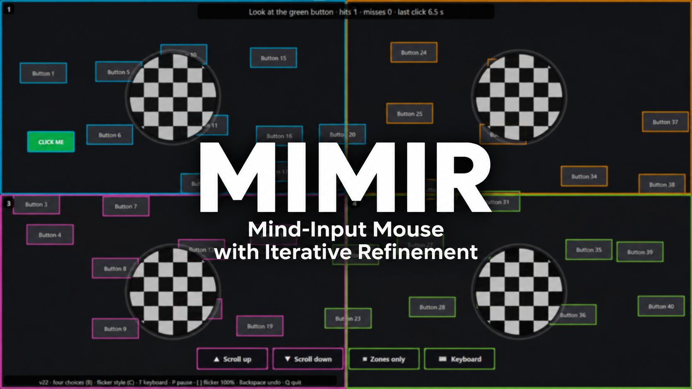
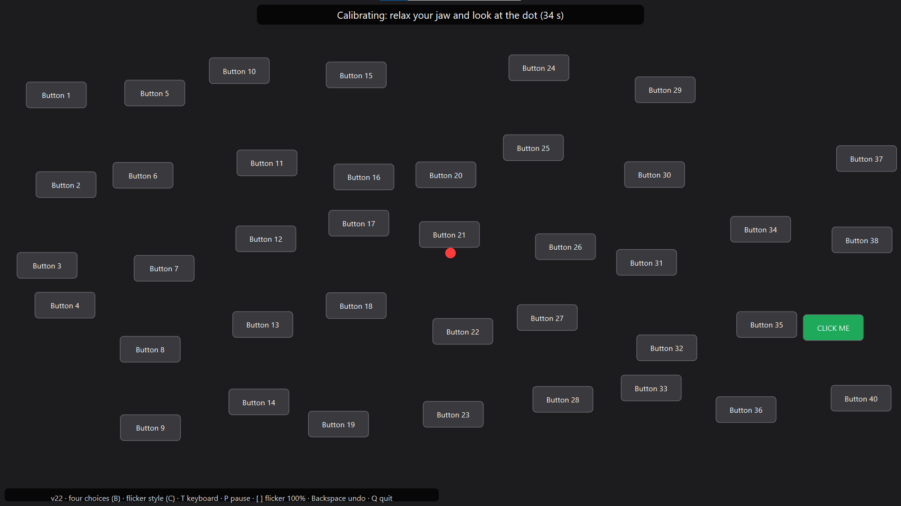
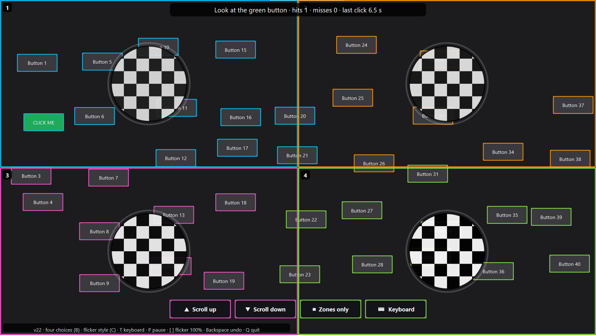
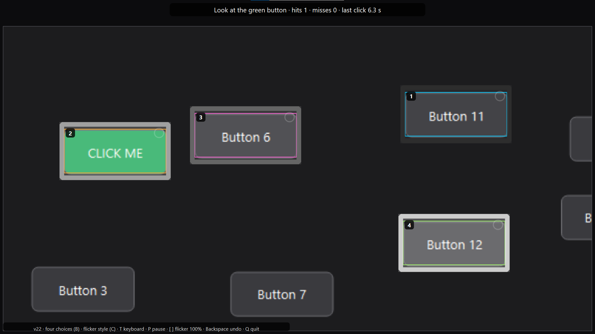
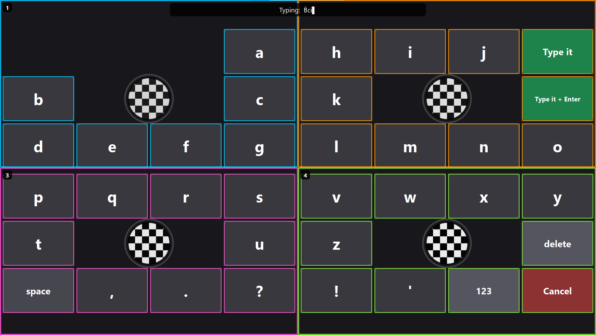
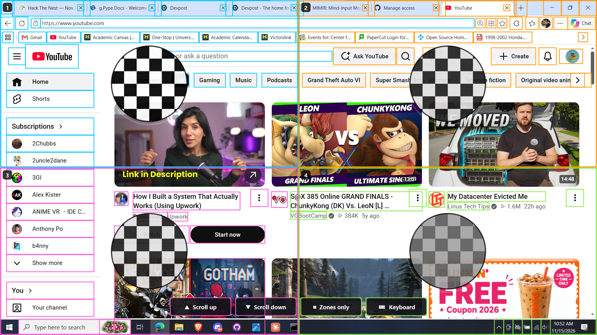

<p align="center">
  
</p>

<p align="center">
  <b>Click anything on your computer by looking at it.</b><br>
  A hands-free mouse for people who cannot use their hands, driven by a g.tec Unicorn EEG headset.
</p>

---

## How it works

The screen is split into up to four regions, each flickering at its own speed
(9, 10, 12 and 15 Hz). Looking at one makes your visual cortex echo that
frequency, and the decoder picks it up from the EEG (SSVEP).

1. **Pick a region.** The view narrows to what's inside it. The first step
   always shows every region so the whole screen stays reachable; after that,
   regions with nothing clickable are skipped.
2. **Zoom in.** Once 16 or fewer targets are left, the view is enlarged so the
   boxes and what's in them are big.
3. **Pick the button.** At the last step (4 or fewer left) every candidate gets
   its own box.
4. **Choose the action.** The view zooms back out and asks *Left click / Double
   click / Right click / Cancel*. For a text box it asks *Type here / Left
   click / Right click / Cancel*.

A short jaw clench undoes the last step (on the first step, it switches to the
plain pixel grid and back). A long one goes back to the start, or pauses if
you're already there.

<table>
  <tr>
    <td align="center" colspan="2"><a href="docs/screenshots/calibrate.png"></a><br><sub><b>1.</b> Calibrate: relax and look at the dot</sub></td>
    <td align="center" colspan="2"><a href="docs/screenshots/quadrant.png"></a><br><sub><b>2.</b> Look at a region's checkered circle</sub></td>
    <td align="center" colspan="2"><a href="docs/screenshots/button.png"></a><br><sub><b>3.</b> Last step: one box per button</sub></td>
  </tr>
  <tr>
    <td align="center" colspan="3"><a href="docs/screenshots/type.png"></a><br><sub><b>4.</b> Type with the on-screen keyboard</sub></td>
    <td align="center" colspan="3"><a href="docs/screenshots/youtube.png"></a><br><sub><b>5.</b> Works on the real desktop</sub></td>
  </tr>
</table>

> [!WARNING]
> The regions flicker at 9–15 Hz, which can trigger seizures in people with
> photosensitive epilepsy. Don't run it with or near anyone who has that
> condition, and say so before any demo.

## Getting started

All the code lives in [`Unicorn-quadclick/`](Unicorn-quadclick); run the
commands below from there.

```
cd Unicorn-quadclick
pip install -r requirements.txt
```

On Windows you can double-click the numbered launchers instead. Each one first
closes any MIMIR program left running.

| Launcher | What it does |
|---|---|
| `0_stop_all.bat` | Close anything still running |
| `1_install.bat` | Install dependencies (once) |
| `2_demo_keyboard.bat` | Practice screen, keyboard only |
| `3_demo_brain_replay.bat` | Practice screen driven by recorded EEG |
| `4_live_unicorn_practice.bat` | Practice screen with the real headset |
| `5_desktop_hotkeys.bat` | Real desktop, Ctrl+Alt hotkeys, no headset |
| `6_desktop_live_unicorn.bat` | Real desktop with the headset |
| `7_desktop_direct_keys.bat` | Real desktop, plain `1`–`4` keys, no headset |

The practice screens never click anything real.

### 1. Practice with the keyboard

```
python overlay.py --demo --keys-only
```

Press the number shown on a box to pick it. `--keys-only` ignores the decoder,
so a replay left running can't drive it.

### 2. Practice with recorded brain data

No headset needed. A simulated user "looks" at the green button by playing
back g.tec recordings of a real person looking at that flicker frequency,
through the same decoder the headset uses.

```
python overlay.py --demo        # terminal 1
python replay_dataset.py        # terminal 2  (--subject 2 is the harder one, --speed 4 is faster)
```

### 3. Live with the Unicorn headset

Windows laptop with g.Pype.

```
python overlay.py --demo        # terminal 1 (drop --demo to click the real desktop)
python run_live_gpype.py        # terminal 2
```

For the first 40 s, relax your jaw and look at the red dot while it
calibrates. Then look at a region to pick it.

### 4. On the real desktop

```
python overlay.py --keys-only   # hotkeys only: try this first
python overlay.py               # plus the decoder (run_live_gpype.py in a second terminal)
```

A see-through layer sits over everything and lets mouse clicks fall through.
It starts paused; hold **Ctrl+Alt** and press `P` to start. The clicks at the
end are real. Only the main display is covered.

## Controls

In the practice screen press the keys directly. On the real desktop hold
**Ctrl+Alt** with them (or use launcher 7 for plain keys).

| Key | Action |
|---|---|
| `1` – `4` | Pick the box with that number |
| `Backspace` | Undo the last step |
| `Home` | Start over (`Esc` also works in practice) |
| `P` | Pause or resume |
| `B` | Two or four choices per step |
| `C` | Flicker style: checkered circles / plain circles / whole box |
| `M` | Real buttons or pixel grid |
| `T` | Open the keyboard for whatever has the text cursor |
| `[` `]` | Softer / stronger flicker |
| `Q` | Quit |

## Finding things to click

- **Real buttons** (default) asks Windows UI Automation, the interface screen
  readers use, for the buttons, links and menu items of the front window, the
  taskbar and any open pop-up menu. It only knows what a program reports about
  itself.
- **Icon finder** (`--finder icons`, launchers 5–7) adds a look at the pixels of
  windows that describe little about themselves, such as games. Everything
  stays on the PC.
- **Pixel grid** (`M`, or automatically when fewer than two buttons are found)
  reaches any spot on the screen in about 5 picks on a full-HD display.

A **toolbar** along the bottom adds *Scroll up*, *Scroll down*, *Zones only*
(pixel grid on/off) and *Keyboard*. Its buttons are picked like anything else.
`--no-menu` skips the click-type question and always left-clicks.

## Typing

*Type here* clicks the text box and opens an on-screen keyboard. Keys are
picked just like buttons, about 3 picks per letter with four choices. The
text builds up at the top and is only sent when you pick **Type it** (or
**Type it + Enter**), so mistakes get fixed first.

- Three suggested words (blue keys) follow what you've typed.
- A short jaw clench on the keyboard's first step deletes the last letter.
- **123** switches to digits and symbols; **Cancel** closes without typing.

## Comfort

- Each region has a **checkered circle** whose squares swap 9–15 times a
  second, so overall brightness never changes. Look at the circle of the
  region you want. At the last step the whole (small) box flickers instead.
- The flicker is a smooth sine wave, fades in over 0.6 s after each pick, and
  stops completely while calibrating or paused.
- Pause with `P`, or hold a jaw clench on the full screen.
- `[` / `]` or `--contrast 0.6` softens it. Softer is gentler but gives a
  weaker signal; find the lowest setting that still works for each person.
- `--fill 0` flickers only the frame so the content inside stays readable.

## Results

Replaying the g.tec SSVEP dataset (2 subjects, 4 targets, 8 electrodes)
through the live decision rule, 40 trials per subject:

| Subject | Right | Wrong | No answer | Time per pick |
|---|---|---|---|---|
| 1 | 40 | 0 | 0 | 2.4 s |
| 2 | 36 | 2 | 2 | 3.9 s |

A full click on a screen of about 64 buttons takes 3 picks, roughly 10 s for
subject 1 and 15 s for subject 2. Some people give a much stronger signal than
others, so calibrate each person.

Full numbers, what's been tested, and tuning notes are in
[docs/details.md](docs/details.md).

## Project layout

| File | What it does |
|---|---|
| `overlay.py` | On-screen regions, zooming, undo, click, demo screen |
| `run_live_gpype.py` | Unicorn → g.Pype → decoder → overlay |
| `replay_dataset.py` | Simulated user driven by the g.tec recordings |
| `evaluate_dataset.py` | Offline scoring, writes `results.png` |
| `send_cmd.py` | Send a command to the overlay by hand |
| `bci/config.py` | Every setting worth tuning |
| `bci/ssvep.py` | SSVEP decoder (CCA + idle baseline) |
| `bci/clench.py` | Jaw-clench detector |
| `bci/engine.py` | EEG chunks in, commands out |
| `bci/splitter.py` | How an area is cut into regions |
| `bci/elements.py` | Finds real buttons via Windows UI Automation |
| `bci/icon_finder.py` | Second button finder, with a local vision pass for games |
| `bci/keyboard.py` | On-screen keyboard layout and word suggestions |
| `bci/winutil.py` | Global hotkeys, the real click, front-window check (Windows) |

The decoder and the overlay talk only over UDP text messages on localhost
(`SEL 2 4.10`, `CLENCH_SHORT`, `LAYOUT …`), so they can be developed
separately.
